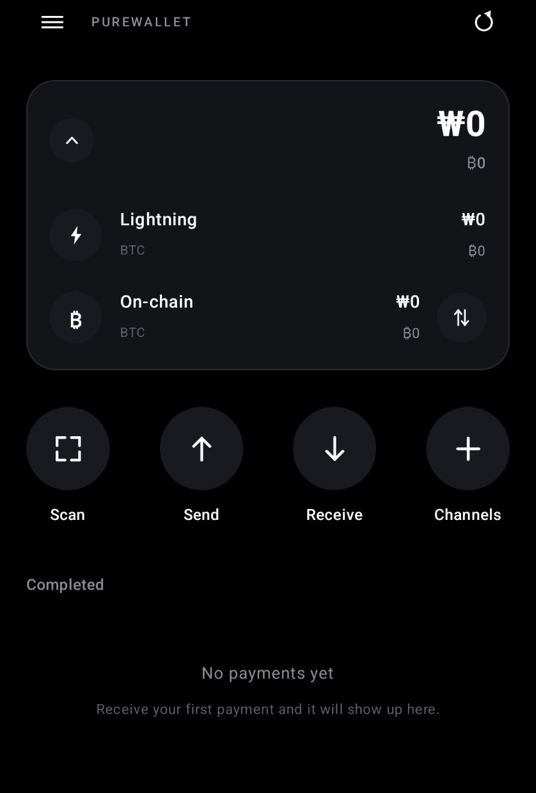

<p align="center">
  
</p>

<h1 align="center">ZeroWallet</h1>

<p align="center"><b>Pure on-device P2P Lightning &amp; Bitcoin wallet. Zero LSPs. Zero servers. Zero telemetry.</b></p>

<p align="center">
  <a href="https://github.com/CoreJBH/zerowallet/releases/latest"></a>
  
  
  
  
</p>

<p align="center">
  
</p>

ZeroWallet is a native Android wallet (Kotlin + Jetpack Compose) built around
[LDK Node](https://github.com/lightningdevkit/ldk-node). The Lightning node, the on-chain
wallet and the keys all live on the phone: there is no account, no backend, no LSP and no
custodian anywhere in the payment path. Channels are opened peer to peer with a
`pubkey@host:port`, and nothing of the app ever appears in the notification bar: no
foreground service, no ongoing notification. When the wallet comes back to the screen it
reconnects and resyncs by itself.

The name is the design rule: zero LSPs, zero servers, zero telemetry.

The look is deep navy (Prussian blue): a `#060D24` canvas, `#0A1535` cards,
`#0E1C47` raised surfaces, hairline `#1C2F66` borders, royal-blue `#3B82F6` actions with
`#60A5FA` highlights, ice-white `#F1F5FF` type and green incoming amounts.

**Download.** Grab the APK from [Releases](https://github.com/CoreJBH/zerowallet/releases/latest)
and install it (allow "install unknown apps" for the app you open it with). Debug-signed,
so a reinstall needs the previous build removed first.

---

## What it does

- **Bitcoin mainnet by default.** Signet and Testnet3 are selectable in Settings for
  testing; a small network badge appears only when the wallet is not on mainnet.
- **Blockstream's Esplora as the default chain source, with automatic fallback.** Mainnet
  starts on `https://blockstream.info/api`. That endpoint can time out from a phone network,
  and ldk-node then fails the whole start with `FeerateEstimationUpdateTimeout`: so when the
  saved endpoint does not answer, the same start is retried on `https://mempool.space/api`
  and then `https://mempool.emzy.de/api`, and the node says which server it is reading. The
  endpoint that came up last is remembered and tried ahead of the remaining fallbacks. An
  endpoint typed into Settings is the user's own choice and is never swapped for a public
  one. A different Esplora endpoint can be typed into Settings, and saving it restarts the
  node so the new source is in use right away instead of waiting for the next start.
- **On-chain wallet.** Receive to a freshly derived address, send with Normal/Fast fee
  priorities taken from the network fee estimator, or sweep the whole balance. The
  confirmation screen shows the entire destination address in monospace, wrapped over as
  many lines as it needs, never an abbreviation. The address must carry the prefix of the
  chain the wallet is on (`bc1`/`1`/`3` on mainnet, `tb1`/`m`/`n`/`2` on the test chains),
  so a test-chain address pasted on mainnet is refused before anything is signed. Amounts
  are read as exact decimals: more than the 21 million BTC supply, a sub-satoshi remainder
  or a value that would overflow is refused instead of paid.
- **Lightning.** Create BOLT11 invoices and BOLT12 offers, pay BOLT11 invoices, BOLT12
  offers and BOLT12 invoices, and use unified BIP-21 / Lightning QR requests.
- **Direct P2P channels.** Connect to a peer with `pubkey@host:port`, open a channel from
  the on-chain balance, then close cooperatively or force close. No LSP, no just-in-time
  channel service, no channel-opening fee to a third party.
- **QR everywhere.** Camera scanning for invoices, offers, BIP-21 URIs and peer addresses;
  QR rendering for everything the wallet hands out.
- **Live fiat value.** BTC/KRW (with a USD fallback) from public price endpoints, and a
  graceful dash instead of a stale number when the phone is offline.
- **Real history.** Payments are read from the node's own database; local invoice notes
  stay on the device.
- **12 or 24 words.** A new wallet can be created from 128-bit (12 words) or 256-bit
  (24 words) entropy; both restore the same way.
- **One numbered box per word when restoring.** The phrase is entered in a 12- or 24-box grid
  (three columns, one word per box) instead of a single long field. As soon as the letters
  typed in a box name exactly one BIP-39 word, the box fills itself and the caret jumps to the
  next one; ambiguous prefixes (`act` -> act, action, actor, actress, actual) show tappable
  suggestion chips right above the keyboard. Deleting never triggers a jump, backspace in an
  empty box steps back one box, and pasting a whole phrase (spaces, newlines, commas or a
  numbered list) spreads it over the boxes, switching the grid to 24 words when the paste is
  longer than 12.
- **Encrypted channel backup.** The node store (channel manager and monitors, on-chain wallet,
  node keys) is packed into one `.zwbackup` file sealed with AES-256-GCM under a key derived
  from the recovery phrase with PBKDF2-HMAC-SHA256: 210,000 iterations and a random 16-byte
  salt that rides in the header (format 3). Android's own file picker saves it to Google
  Drive or anywhere else, or the share sheet does, with no Google Play Services and no OAuth.
  Backups written by older builds (format 2 with HKDF-SHA256, format 1 with one SHA-256)
  still open, because the version byte says which derivation to use. Restoring it on a
  replacement phone after entering the phrase brings the open channels back, and asks for the
  same proof as a payment first. Importing is bounded (64 MB file, 4096 entries, 128 MB
  unpacked) so a wrong pick or a crafted archive cannot exhaust the phone, and the plaintext
  store is zeroed as soon as it has been read or written.
- **A confirmation that proves something.** Confirming a new backup asks for two words drawn
  at random from the phrase (never a fixed pair that anyone who has seen the app would know),
  in password fields with autocorrect off, so neither the words nor the answer reach a
  keyboard's learned history.
- **Never ₿0 while it starts.** A start takes seconds (the node opens its store and syncs
  with Esplora). The last known on-chain and Lightning balance, block height, sync time and
  payment list are kept on the device after every real sync and shown while the node comes
  up, so opening the wallet or switching back never flashes a zero balance. The first real
  sync replaces them.
- **A node that stays up and says why it stops.** A start that fails no longer leaves a bare
  "Stopped" and a zero balance: the reason is shown under the node status in Settings and as
  a banner on the home screen with a Try again button. If port 9735 cannot be bound (another
  node holds it, or the phone refuses it), the node is started again without a listening
  address so on-chain sync, payments and open channels keep working - and without a node
  alias, which LDK Node only accepts alongside a listening address. Every start and stop
  goes through one lock, so a restart picked while the node is coming up is queued instead
  of dropped. Coming back to the wallet quietly syncs a node that survived the screen being
  elsewhere, brings back one Android killed, and respects a node the user stopped - that
  stop is written to disk, so a killed process does not undo it.

## Security

- **Authentication before money moves, and a gate that fails closed.** Sending a payment,
  funding or closing a channel, restoring a channel backup, showing the recovery phrase and
  wiping the wallet always ask for a biometric or the device screen lock first. One prompt
  accepts a strong biometric or the screen lock on Android 11+; on older versions only a
  class-3 biometric is accepted, with the screen lock as the fallback button, and a weak face
  unlock is never the whole proof. When the phone has no screen lock there is nothing to
  prove it is you with, so those actions are refused: a dialog says so and opens the Android
  security settings, and receiving keeps working. The same answer is given when the system
  reports it cannot authenticate right now. Whether a lock exists is re-read on every
  resume, so removing it outside the app is noticed at once rather than after a restart.
- **The seed is bound to the phone's lock, in the Keystore itself.** On Android 11+ on a
  phone with a screen lock, the key that decrypts the recovery phrase is created with
  `setUserAuthenticationRequired(true)` and a 60-second validity window: the Keystore only
  releases it shortly after the user authenticated, so a shell, a hooked callback or a
  bypassed screen cannot read the phrase, and a process that has been sitting in the
  background has to ask again. The same AES material is imported twice - an encrypt-only
  alias with no such requirement (sealing a new or restored phrase asks nothing) and the
  decrypt-only alias above - so nothing can read the phrase with the alias that writes it.
  Opening the wallet after Android closed the app can therefore ask for the screen lock even
  with lock-on-open off; the prompt is the same one. A wallet written by 1.1.10 or earlier is
  moved onto this pair the first time it is opened.
- **A screen-lock change is reported, not hidden.** Removing or resetting the phone's lock
  invalidates that key by design, and the ciphertext cannot be opened by anything on the
  device afterwards. The wallet says exactly that and sends the user to restore with the
  recovery phrase instead of showing a generic error or a blank setup screen.
- **Optional lock on open.** Off by default, a switch in Settings makes the app ask every
  time it opens and after coming back from the background. The prompt is lifecycle-driven:
  it restarts cleanly on resume, so the Unlock button cannot go dead after backgrounding.
- **No screenshots, no Recents thumbnail.** The window is `FLAG_SECURE`, so the wallet is
  blocked from screenshots and screen recording and blanked in the recent-apps list. The
  recovery phrase and the setup/restore screens force it on even if the setting is off.
- **Seed at rest.** The BIP-39 mnemonic is generated with `java.security.SecureRandom`,
  its entropy buffer is zeroed right after the words exist, and it is stored only as
  AES-256-GCM ciphertext under a non-exportable Android Keystore key. Android backup is
  disabled for the app. The restore boxes are password fields with autocorrect off, so the
  phrase never reaches a keyboard's learned words or suggestion strip.
- **Balance cache and payment notes are sealed too.** The last synced amounts, block height
  and history, and the note kept for each invoice, are AES-256-GCM ciphertext under another
  non-exportable Keystore key (`v1:` prefixed in the preferences file). That key is not bound
  to the lock: those records are needed the instant the wallet opens and can be rebuilt by
  syncing, so a lost key costs a sync rather than funds. A value written by an older build is
  still read and is re-sealed on the next save.
- **A clipboard that does not show what it holds.** Copying an invoice, offer, address or
  node id marks the clip with `EXTRA_IS_SENSITIVE` on Android 13+, so the system does not
  draw it in the clipboard preview where anyone nearby can read it before it is pasted.
- **HTTPS-only chain source, with one address that cannot be spoofed.** A custom Esplora
  endpoint must be `https://`; plain `http://` is accepted only for `127.0.0.1` and
  `localhost`, the two names the platform's network security config permits cleartext for.
  The lists are identical on purpose and a unit test compares them: a `domain` entry matches
  a host name, not an address block, so accepting a wider range in the app would save an
  endpoint whose every request the system then blocks. Credentials, query strings and
  fragments in the URL are rejected, and a stored value that no longer passes is ignored in
  favour of the built-in default.
- **Fees that cannot be talked into overpaying.** Fee estimates are parsed as JSON (a string
  inside the reply cannot become a rate), skipped when they are not numbers, and clamped to
  1..1000 sat/vB before the node turns them into a `FeeRate`. The send confirmation shows
  both the rate and the estimated total (`rate × ~size` for one input and one change output),
  so the number that leaves the balance is on screen next to the number it came from. A rate
  of 100 sat/vB or more, or a fee of more than 10% of a payment of 1,000 sats or more, stops
  the send behind its own confirmation with both numbers; such a reply means the endpoint is
  wrong or reading a spike, not that the user meant to pay it.
- **Duplicate BIP-21 amounts are refused.** BIP-21 does not say which `amount` wins, so a QR
  with two of them can be read as a different payment by another wallet. The send screen
  refuses the request and says why instead of picking one of the numbers.
- **BOLT12 stays on its chain.** A BOLT12 invoice names its chain by genesis hash and an offer
  by the chains it accepts; both are checked against the running network before the payment
  screen, along with the bech32 shape of the string (`lno1`/`lni1` with a valid data part), so
  a truncated offer or an invoice from another chain is refused where it can still be fixed.
- **A BIP-21 QR that offers both halves.** When a QR carries `lightning=` next to the address,
  the wallet resolves that invoice too and pays over Lightning when a usable channel has the
  outbound balance for it and both halves agree on the amount; the on-chain address stays one
  tap away and is used unchanged whenever the Lightning half is expired, from another chain,
  a different amount, or unpayable right now.
- **One lock around the node.** Every JNI call into ldk-node runs on an IO thread while the
  node is held by the same mutex that serialises starts and stops, so a stop, wipe or
  restart can never destroy a node a sync or payment is still using. A stop also waits for
  the event loop to leave its blocking native call before the node is destroyed.
- **Wipe leaves nothing readable.** Wiping the wallet asks for the same proof as a payment
  first, then deletes the seed, the Android Keystore keys that sealed it (both halves), every
  chain's node data, the sealed payment notes, the settings (sealed balance cache included),
  the node log (which names peers and channels) and the cache copies of exported backups,
  including the backup directory under `cacheDir`. Deleting the ciphertext alone would leave
  the keys behind for any old copy of the preferences file.
- **Only the last shared backup stays in the cache.** The share sheet reads a file from the
  app's own cache through a `FileProvider` URI; a new share deletes the previous copy, so the
  phone does not accumulate sealed copies of channel data.
- **No plaintext node log in a release build.** `ldk-node`'s filesystem logger writes
  addresses, peers and channel ids to `logs/ldk-node.log`, so it is enabled only in a debug
  build; a release build starts the node without it and removes a log left by an older
  install. Exception logging in the node manager is behind `BuildConfig.DEBUG` for the same
  reason, and the release build is `isMinifyEnabled`, `isShrinkResources` and not debuggable.
- **Bounded logs.** In a debug build `logs/ldk-node.log` is capped at 2 MB and rotated with
  two archives while the node is stopped, so a long-running install cannot fill the phone
  with logs.
- **No phone-home.** No analytics, no crash reporting, no remote logging. Network requests
  are limited to the configured Esplora endpoint (or another public Esplora when the saved
  one is itself a public default that did not answer) and public price endpoints.

## Architecture

```
Compose UI  ──  WalletViewModel  ──  NodeManager (singleton)
                                        │
                                        ├── ldk-node 0.7.0 (Kotlin/UniFFI + Rust .so)
                                        │     ├── BOLT11 / BOLT12 payments
                                        │     ├── channel manager, peer connections
                                        │     └── BDK on-chain wallet
                                        │
                                        ├── Esplora chain source (HTTPS)
                                        ├── gossip: Lightning P2P (default) or RGS snapshot
                                        ├── seed: AES-256-GCM, split Keystore keys (read = device lock)
                                        ├── app lock: BiometricPrompt + device credential
                                        └── sealed cache: balance snapshot and notes (Prefs)
```

- `core/NodeManager.kt` owns the single `Node` instance, its event loop and every wallet
  action. Balances, payments, channels and peers are read from the node, never invented.
  A mutex serialises every start and stop.
- `core/NodeLifecycle.kt` holds the start and stop rules as plain Kotlin - when a return to
  the foreground brings the node back, when it only resyncs, when "Stop node" keeps it down,
  and the order of listening attempts (port 9735, then none) - so they are unit tested
  without a phone.
- `core/EsploraFallback.kt` orders the endpoints a start tries and tells a chain-source
  failure from a Lightning-port failure, with no Android APIs so it is unit tested.
- `core/WalletCache.kt` encodes the last known balances and history and hydrates the wallet
  state with them while the node starts.
- `core/SecureStore.kt` encrypts the BIP-39 mnemonic with a non-exportable Keystore key pair
  (encrypt-only alias, decrypt-only alias bound to the device lock) and Android backup is
  disabled for the app, so the ciphertext never leaves the device. `core/SecretStore.kt`
  seals the balance cache and the payment notes with a separate Keystore key.
- `core/AppLock.kt` wraps `BiometricPrompt` with the screen-lock fallback and exposes the
  availability check the UI uses to explain the setting on phones without a lock; without a
  lock the sensitive actions are refused rather than let through.
- `core/SensitiveClipboard.kt` copies a request or address with `EXTRA_IS_SENSITIVE`, so the
  system clipboard preview does not show it.
- `core/ScreenSecurity.kt` applies `FLAG_SECURE` to the wallet window.
- `core/EsploraUrl.kt` holds the endpoint rules; `core/Prefs.kt` refuses to store anything
  that fails them.
- `core/FeeEstimates.kt` reads the standard Esplora `/fee-estimates` reply as JSON
  (confirmation target to sat/vB, clamped to 1..1000), so fee estimates work on any Esplora
  endpoint rather than only on mempool.space's numbered helper; `OnchainFeeEstimate` turns a
  rate into the total shown on the confirmation screen, and `FeeWarning` decides when that
  total is unusual enough to stop the send behind its own confirmation.
- `core/NodeLog.kt` rotates the LDK log file with a size cap.
- `core/Bip39.kt` implements BIP-39 generation and validation in plain Kotlin, covered by
  unit tests against the official vectors.
- `core/Market.kt` fetches the BTC price and Esplora fee estimates over HTTPS.

## Known limits

- **A recovery phrase restores on-chain bitcoin, not open channels.** Channel state lives on
  this phone (`ldk-node` storage). There is no hosted SCB or VSS service: the phone only
  writes a channel backup when the user saves one (Settings, encrypted with the phrase), and
  nobody recovers it for them. Without such a file a lost phone loses the funds in open
  channels. A backup is a snapshot too, so a channel that changed after it was saved may close
  when restored. The app says so before showing the phrase and at the top of the channel
  screen; keep channel amounts small.
- Channel funds need an on-chain reserve (about 1% of channel size) plus funding fees, and
  closing a channel costs an on-chain transaction.
- Testnet4 is not exposed by ldk-node 0.7.0, so Testnet3 is the test network offered.
- The LDK native library ships as an unstripped Rust build: the debug APK is about 55 MB
  for the two ARM ABIs.
- BOLT12 and inbound Lightning need network reachability; a phone behind carrier NAT cannot
  accept inbound connections without port forwarding.
- This is a self-custody wallet at `1.1.11`: keep amounts you are willing to lose while the
  peer-to-peer flows get real-world mileage.

## Build

Requirements: JDK 17, the Android SDK (compileSdk 35), and a phone on Android 8.0
(API 26) or newer with an ARM CPU (`arm64-v8a` or `armeabi-v7a`).

```bash
# Debug APK
./gradlew assembleDebug
# -> app/build/outputs/apk/debug/app-debug.apk

# Unit tests and lint
./gradlew testDebugUnitTest
./gradlew lintDebug
```

A release build is signed only with a real release key, passed as Gradle properties or
environment variables: `ZEROWALLET_KEYSTORE`, `ZEROWALLET_KEYSTORE_PASSWORD`,
`ZEROWALLET_KEY_ALIAS` and `ZEROWALLET_KEY_PASSWORD`. With none of them set,
`./gradlew assembleRelease` produces an unsigned APK rather than silently signing with the
debug key; with only some of them set, the build stops with a message saying what is missing,
and a keystore path that does not exist fails the build instead of producing an artifact.

The repository also ships `.github/workflows/apk.yml`, which builds the same APK on Ubuntu
with JDK 17 and the Android SDK, runs the unit tests, and uploads the result as a build
artifact on every push to `main` and on `v*` tags (the workflow keeps its original
`purewallet.apk` artifact name).

## Verification

| Check | Command | Result |
| --- | --- | --- |
| Kotlin + Compose compilation | `./gradlew assembleDebug` | builds `app-debug.apk` |
| Unit tests | `./gradlew testDebugUnitTest` | 208 tests: BIP-39 vectors, word suggestions and the restore-word grid (auto-completion, jumps, paste), exact BTC amount parsing against the 21 million cap, duplicate BIP-21 amount refusal, backup encryption round trip, format 3 (PBKDF2 with salt), format 2 (HKDF) and format 1 compatibility, archive entry limits and refusals, endpoint rules including the cleartext allowlist compared against `network_security_config.xml` and the mainnet default, address-prefix chain matching, BOLT12 shape and chain-hash checks, the BIP-21 `lightning=` hand-off, random backup confirmation words, Esplora fee JSON with quoted numbers and the 1..1000 clamp, estimated total fee, the high-fee warning rules, restart-on-endpoint-change, multi-Esplora fallback order and dedup, chain-source failure detection, cached balance hydration and history round trip, node start/stop rules (foreground recovery, quiet resync, manual stop, port 9735 fallback), log rotation, lock lifecycle |
| Android lint | `./gradlew lintDebug` | 0 errors, 21 warnings |
| Release build (R8) | `./gradlew assembleRelease` | minified and shrunk, LDK/JNI kept by `proguard-rules.pro`; unsigned when no release key is configured, and the build stops on a half-configured key |
| English-only repository | `python3 verify-english.py` | no non-English characters |
| Package / label | `aapt2 dump badging app-debug.apk` | `com.jbitmstr.purewallet`, label `ZeroWallet` |

## Repository layout

```
app/src/main/java/com/jbitmstr/purewallet/
  MainActivity.kt            single activity host, screenshot blocking
  PureWalletApp.kt           application graph
  WalletViewModel.kt         UI bridge
  core/                      node, node lifecycle rules, seed, app lock, channel backup, endpoint rules, log rotation, market data
  ui/                        home screen, lock screen, sheets, word-box setup and scanner
app/src/test/                BIP-39, restore-word grid, channel backup, endpoint, node lifecycle, log rotation and lock lifecycle tests
docs/icon.png                launcher icon artwork
docs/preview.jpg             the screenshot above
.github/workflows/apk.yml    CI build
verify-english.py            English-only guard
```

The Kotlin package and `applicationId` stay `com.jbitmstr.purewallet` so an install over an
older build keeps the same app data. The seed's Keystore keys changed shape in 1.1.11 (a
split encrypt/decrypt pair), so the stored seed of an older install is opened once with its
old key and re-sealed under the new one on first launch instead of asking to restore.

## Contributors

- **[@CoreJBH](https://github.com/CoreJBH)** - creator, product direction and design
- **Gilbert ([Pickle](https://pickle.com))** - AI co-builder: architecture, Kotlin/Compose
  implementation, build verification and review

Third-party components: [LDK Node](https://github.com/lightningdevkit/ldk-node)
(MIT / Apache-2.0), [ZXing](https://github.com/zxing/zxing) (Apache-2.0), AndroidX and
CameraX (Apache-2.0).
